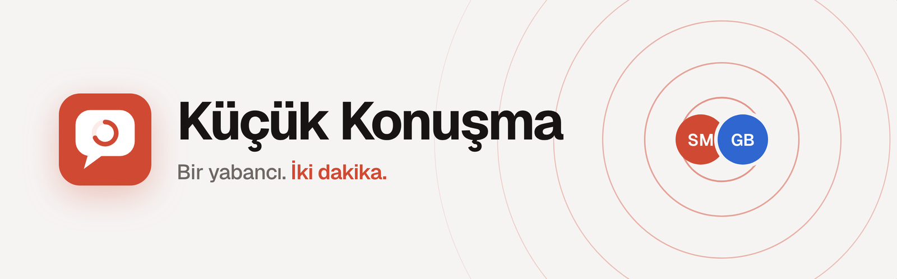
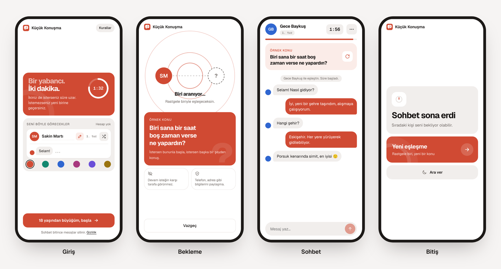
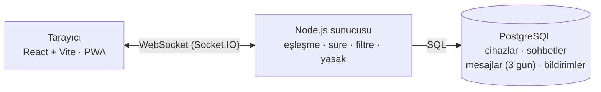

<p align="center">
  <picture>
    <source media="(prefers-color-scheme: dark)" srcset="docs/images/banner-koyu.png">
    
  </picture>
</p>

<p align="center">
  <a href="https://kucukkonusma.169-58-194-231.sslip.io"><b>Projeyi incele</b></a>
</p>

<p align="center">
  
  
  
  
  
</p>

Küçük Konuşma seni rastgele biriyle eşleştirir ve iki dakikalık yazılı bir sohbet başlatır. Süre bitince ikiniz de devam etmek isterseniz sohbet uzar. Biriniz istemezse sohbet biter ve iki taraf da aynı "Süre doldu" ekranını görür. Kimin istemediği hiçbir zaman söylenmez.

Kayıt yok, profil yok, geçmiş yok. Bir rumuz, bir renk ve iki dakika.

> **English:** Küçük Konuşma ("small talk") pairs two strangers for a two-minute text chat. If both quietly opt in, it gets two more minutes; if not, it simply ends, and nobody finds out who said no.

<p align="center">
  <picture>
    <source media="(prefers-color-scheme: dark)" srcset="docs/images/ekranlar-koyu.png">
    
  </picture>
</p>

## Nasıl çalışıyor

1. **Rumuzunu ve rengini seç.** Hesap açmak yok. Karşı tarafın seni nasıl göreceğini giriş ekranında görürsün.
2. **Eşleşmeyi bekle.** Beklerken bir örnek konu çıkar. Bu sadece buzu kırmak için var; istersen bambaşka bir şeyden konuşursun.
3. **İki dakika konuş.** Son 30 saniyede "Devam etmek ister misin?" sorusu belirir. Cevabını karşı taraf görmez.
4. **İkiniz de isterseniz +2 dakika.** Bu en fazla iki kez olur. Sonra ya da biriniz istemezse yeni birine geçersiniz.

## Neler var

- **Reddedilme yok.** Uzatma kararı sunucuda, gizli olarak verilir. Sohbet bittiğinde iki tarafa da aynı mesaj gider.
- **Örnek konu kartı.** Her sohbette ortak bir soru durur, iki taraf da değiştirebilir. 20 saniye kimse yazmazsa kart hafifçe yeni bir konu önerir.
- **Küfür filtresi.** Mesajlar karşıya gitmeden sunucuda kontrol edilir. Büyük harf, rakamla yazma (`s1kt1r`), araya nokta koyma ve harf uzatma gibi hileleri de yakalar. Yakalanan mesaj karşıya gitmez ve kaydedilmez.
- **Bildir ve uzaklaştır.** 24 saat içinde üç farklı kişiden bildirim alan cihaz 24 saat giremez. Birbirini bildiren iki kişi bir daha eşleşmez.
- **Anonim kimlik.** Tarayıcıya sunucunun imzaladığı rastgele bir cihaz kimliği yazılır. Ad, e-posta ya da telefon numarası istenmez.
- **Mesajlar silinir.** Sohbet bitince mesajlar iki tarafın ekranından da kalkar. Sunucuda yalnızca bildirimleri incelemek için 3 gün tutulur, sonra kendiliğinden silinir.
- **Telefona kurulur.** Ana ekrana eklenebilir (PWA). Klavye açıldığında sohbet ekranı sıkışmaz, daha sade bir düzene geçer.
- **Açık ve koyu tema**, telefonun ayarına göre.

## Mimari



Eşleşme kuyruğu ve çalışan sohbetler sunucunun belleğinde tutulur. Süreyi de sunucu sayar; tarayıcı yalnızca gösterir. Bu yüzden uygulama **tek bir sunucu kopyası** olarak çalışmalıdır.

| Klasör | İçinde ne var |
|---|---|
| [`web/`](web) | Tarayıcı uygulaması. Ekranlar: giriş, bekleme, sohbet, bitiş |
| [`server/`](server) | Node sunucusu: anonim kimlik, eşleşme kuyruğu, sohbet süresi, bildirim ve yasak, eski kayıtların temizliği |
| [`shared/`](shared) | İki tarafın ortak kullandığı kurallar: olaylar, konu kartları, küfür filtresi |

## Bilgisayarında çalıştırma

Gerekenler: Node.js 20 veya üstü ve çalışan bir PostgreSQL.

```bash
npm install

# PostgreSQL yoksa Docker ile:
docker run -d --name kk-db -p 5432:5432 \
  -e POSTGRES_USER=kucuk -e POSTGRES_PASSWORD=kucuk -e POSTGRES_DB=kucuk \
  postgres:16-alpine

npm run dev
```

Uygulama http://localhost:5173 adresinde açılır. Eşleşmeyi denemek için ikinci pencereyi **gizli sekmede** aç; her pencerenin ayrı bir kimliği olmalı. İki dakikayı beklemek istemezsen turu kısalt: `ROUND_SECONDS=20 npm run dev`

```bash
npm run typecheck   # TypeScript kontrolü
npm test            # küfür filtresi testleri
npm run build       # üretim derlemesi (dist/)
npm start           # derlenmiş sürümü çalıştırır
```

## Sunucuya kurulum

Docker ve Docker Compose kurulu bir Linux sunucu yeterli.

```bash
git clone https://github.com/EyakutDev/kucuk-konusma.git
cd kucuk-konusma
cp .env.example .env

# İki zorunlu değeri rastgele üret
sed -i "s/^SESSION_SECRET=.*/SESSION_SECRET=$(openssl rand -hex 32)/" .env
sed -i "s/^POSTGRES_PASSWORD=.*/POSTGRES_PASSWORD=$(openssl rand -hex 16)/" .env
chmod 600 .env

docker compose up -d --build
```

Uygulama `http://SUNUCU_IP:3000` adresinde açılır. Veritabanı tabloları ilk açılışta kendiliğinden oluşturulur.

| İş | Komut |
|---|---|
| Durum | `docker compose ps` |
| Kayıtlar | `docker compose logs -f kucuk-konusma` |
| Sağlık kontrolü | `curl http://localhost:3000/api/health` |
| Güncelleme | `git pull && docker compose up -d --build` |
| Veritabanı yedeği | `docker compose exec -T db pg_dump -U kucuk kucuk > yedek-$(date +%F).sql` |

> [!WARNING]
> `docker compose down -v` veritabanı diskini de siler. Durdurmak için `docker compose stop` kullan.

### HTTPS

Telefona kurulum (PWA) için HTTPS gerekir. En kolay yol uygulamanın önüne [Caddy](https://caddyserver.com/) koymak; sertifikayı kendisi alır ve yeniler.

```
kucukkonusma.ornek.com {
    reverse_proxy localhost:3000
}
```

Sonra `.env` dosyasında `TRUST_PROXY=1` yap ki kullanıcıların gerçek IP adresi okunabilsin, ve 3000 portunu dışarıya kapat.

<details>
<summary><b>Sunucuda zaten Docker içinde çalışan bir Caddy varsa</b></summary>

Uygulamayı o Caddy'nin Docker ağına bağla. Bunun için depoya girmeyen, sadece sunucuya özel bir `docker-compose.override.yml` dosyası oluştur. Compose bu dosyayı kendiliğinden okur.

```yaml
services:
  kucuk-konusma:
    ports: !reset []          # 3000 dışarıya kapalı, sadece Caddy ulaşır
    networks: [default, edge]
networks:
  edge:
    external: true
    name: CADDY_AGININ_ADI     # docker inspect ile bulunur
```

Caddyfile'a eklenecek blok:

```
kucukkonusma.ornek.com {
    reverse_proxy kucuk-konusma:3000
}
```

Alan adın yoksa [sslip.io](https://sslip.io) işini görür: `kucukkonusma.1-2-3-4.sslip.io` adresi `1.2.3.4` IP'sine gider, Caddy bunun için de sertifika alır. Kalıcı kullanım için gerçek bir alan adı önerilir.

</details>

## Ayarlar

Hepsi `.env` dosyasından değiştirilir. Tam liste ve açıklamalar [`.env.example`](.env.example) içinde.

| Ayar | Varsayılan | Ne işe yarar |
|---|---|---|
| `ROUND_SECONDS` | `120` | Bir turun süresi (saniye) |
| `MAX_EXTENSIONS` | `2` | Bir sohbet en fazla kaç kez uzayabilir |
| `REPORT_BAN_THRESHOLD` | `3` | Kaç farklı kişi bildirirse cihaz uzaklaştırılır |
| `REPORT_WINDOW_HOURS` | `24` | Bildirimlerin sayıldığı süre |
| `BAN_HOURS` | `24` | Uzaklaştırma süresi |
| `MESSAGE_RETENTION_HOURS` | `72` | Mesajların sunucuda tutulduğu süre |
| `TRUST_PROXY` | `0` | Caddy, nginx gibi bir ters vekil arkasında `1` olmalı |

## Bilinen sınırlar

- Kimlik tamamen anonim olduğu için uzaklaştırılan biri tarayıcı verilerini silip yeni kimlik alabilir. Bunu yavaşlatmak için bir IP adresinden saatte en fazla 20 yeni kimlik oluşturulabiliyor.
- Küfür filtresi bir kelime listesine dayanıyor ([`shared/filter.ts`](shared/filter.ts)). Her şeyi yakalamaz, zamanla genişletilmesi gerekir.
- Yazı tipi Google Fonts'tan yükleniyor, yani kullanıcının IP adresi Google'a gidiyor. İstenirse yazı tipi sunucuya taşınabilir.
- Uygulama tek sunucu kopyası için tasarlandı. Birden fazla kopya çalıştırmak için eşleşme kuyruğunun Redis gibi ortak bir yere taşınması gerekir.

## Lisans

Bu depo için henüz bir lisans seçilmedi. Kodu kullanmak ya da üzerine bir şey yapmak istersen önce iletişime geç.
